

  

  
  
  
  
  
  

  

  <a href="#-features">Features</a> &nbsp;·&nbsp;
  <a href="#-themes">Themes</a> &nbsp;·&nbsp;
  <a href="#-setup">Setup</a> &nbsp;·&nbsp;
  <a href="#%EF%B8%8F-shortcuts">Shortcuts</a> &nbsp;·&nbsp;
  <a href="#-analytics">Analytics</a>

 

  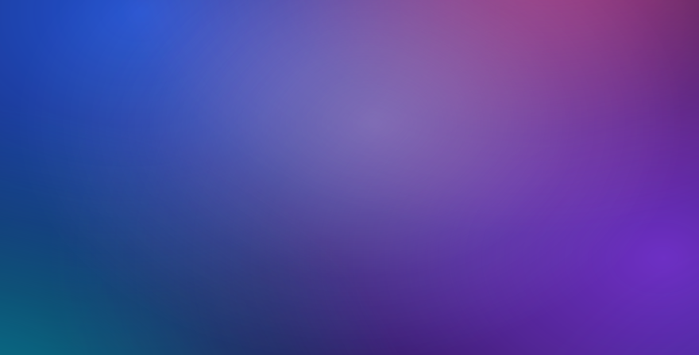

 

## ✨ Features

<table>
  <tr>
    <td width="50%" valign="top">
      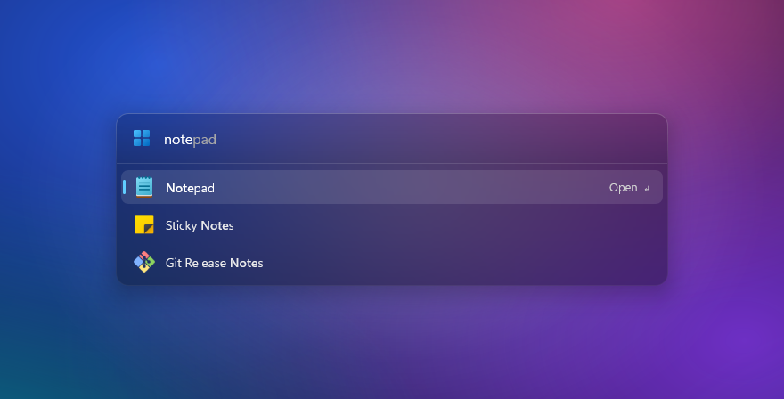
      <h3>Instant app search</h3>
      Press <kbd>Win</kbd> and start typing. Every installed app, including Store apps, shows up as you type, with its icon, matched letters in bold, and an inline completion you can accept with <kbd>Tab</kbd>.
    </td>
    <td width="50%" valign="top">
      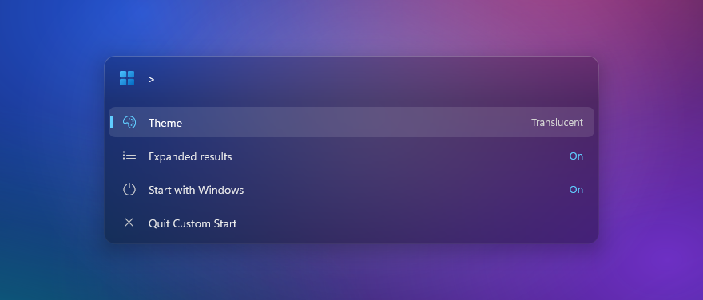
      <h3>Commands with <code>&gt;</code></h3>
      Type <code>&gt;</code> to see your games, manage pinned apps, switch theme or font, turn the results list on or off, start with Windows, or quit. No settings window needed.
    </td>
  </tr>
  <tr>
    <td width="50%" valign="top">
      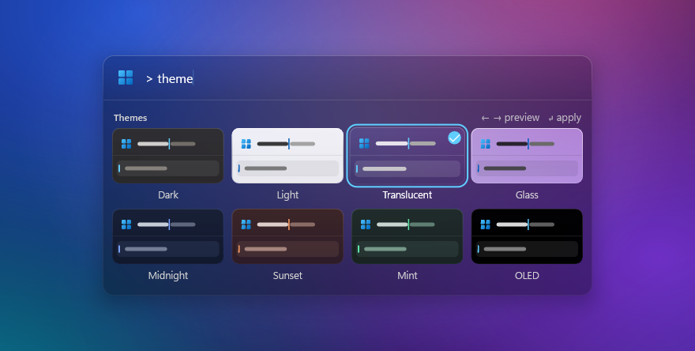
      <h3>Live theme picker</h3>
      <code>&gt; theme</code> opens a grid of live previews. Arrow keys cross-fade the whole bar into each theme, and <kbd>Enter</kbd> applies it.
    </td>
    <td width="50%" valign="top">
      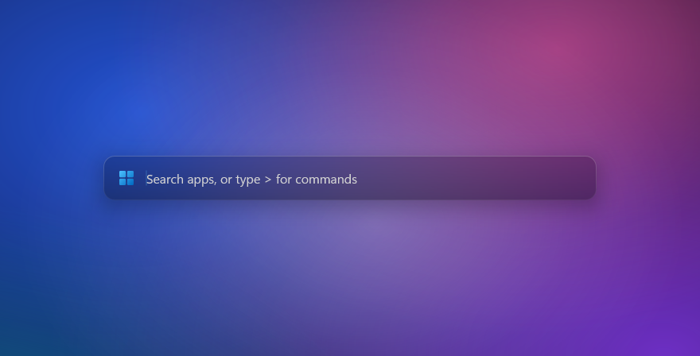
      <h3>Smooth all the way</h3>
      The bar springs open, the caret glides, freshly typed letters fade in, and a frosted, edge-faded backdrop blurs whatever is behind it. Rendered with Direct2D at your display's refresh rate.
    </td>
  </tr>
</table>

- **Replaces the Start menu.** <kbd>Win</kbd>, <kbd>Ctrl</kbd>+<kbd>Esc</kbd> and the Start button all open Custom Start, while shortcuts like <kbd>Win</kbd>+<kbd>E</kbd> and <kbd>Win</kbd>+<kbd>R</kbd> keep working.
- **Your pinned apps, above the bar.** The apps pinned to your Windows Start menu come along as tiles, with names under the icons. Drag them to reorder, right-click to hide or unpin, and type `> pins` to bring hidden ones back.
- **Right-click menu.** Run as administrator, Open file location, Pin to Start and Pin to taskbar, on any app or pinned tile.
- **All your games in one place.** `> games` finds the games on every drive (Steam, Epic, GOG, Ubisoft, Xbox, Riot, EA and more) and starts them. Type after it to filter.
- **More than apps.** Type a path, a command or a URL and it runs or opens. Program names work too, so `cmd` finds Command Prompt. Anything else becomes a web search.
- **Your font.** `> font` opens a picker with 477 free fonts (the whole SF Pro family, plus [open-fonts](https://github.com/kiwi0fruit/open-fonts) sorted into Sans Serif, Serif, Monospace, Math, Symbols & Emoji and fonts for other languages). Each card shows what the font looks like; nothing is downloaded until you click its Download button, and then every bit of text uses it. `> font NAME` searches, and `> fontfolder` opens the folder (`%LOCALAPPDATA%\Programs\CustomStartMenu\Fonts`) so you can add your own `.otf` / `.ttf` files.
- **Stays out of your games.** Hardware acceleration (on by default) draws the bar on your graphics card. It opens on top of fullscreen games and <kbd>Esc</kbd> hands the keyboard straight back. While a game is in front, Custom Start stops watching the mouse and holds update prompts until you're done.
- **Two native backends.** Pick **C++** or **Rust** when you install. Both look and behave the same.
- **Speaks your language.** English, Español, Français, Deutsch, Italiano, Português, Русский, 日本語, 中文 and 한국어.
- **Stays up to date.** New versions show up on their own, with a clear list of what changed.

## 🎨 Themes

Eight built-in themes: **Dark**, **Light**, **Translucent**, **Glass**, **Midnight**, **Sunset**, **Mint** and **OLED**.

<table>
  <tr>
    <td width="50%">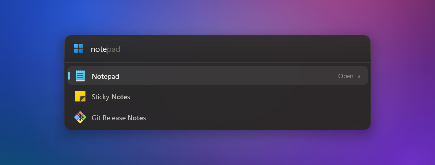
<b>Dark</b>
</td>
    <td width="50%">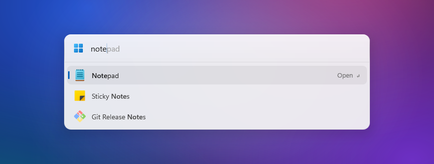
<b>Light</b>
</td>
  </tr>
  <tr>
    <td width="50%">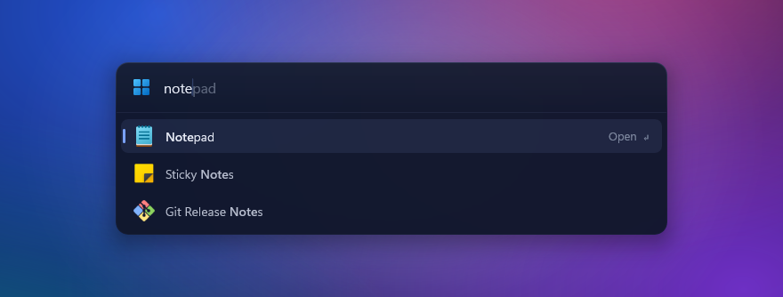
<b>Midnight</b>
</td>
    <td width="50%">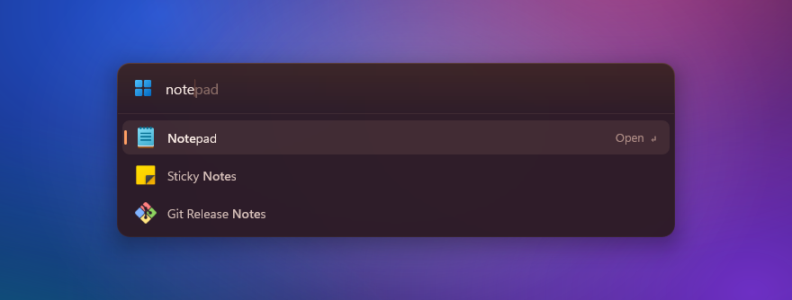
<b>Sunset</b>
</td>
  </tr>
</table>

## 🚀 Setup

Download **[CSMInstaller.exe](https://github.com/mysisnotreal/CustomStartMenu/releases/latest/download/CSMInstaller.exe)** and run it. No admin rights needed.

<table>
  <tr>
    <td width="50%" valign="top">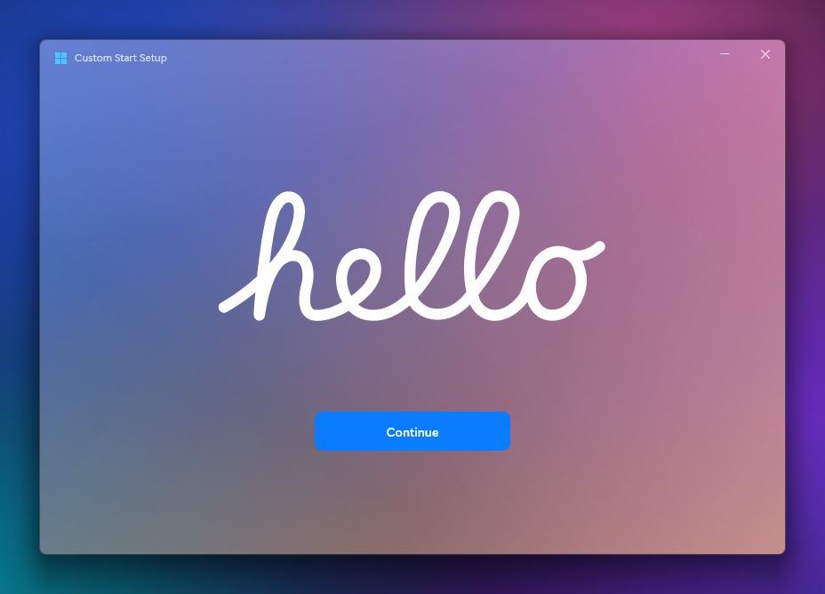
<b>1.</b> A hand-drawn hello in your PC's language
</td>
    <td width="50%" valign="top">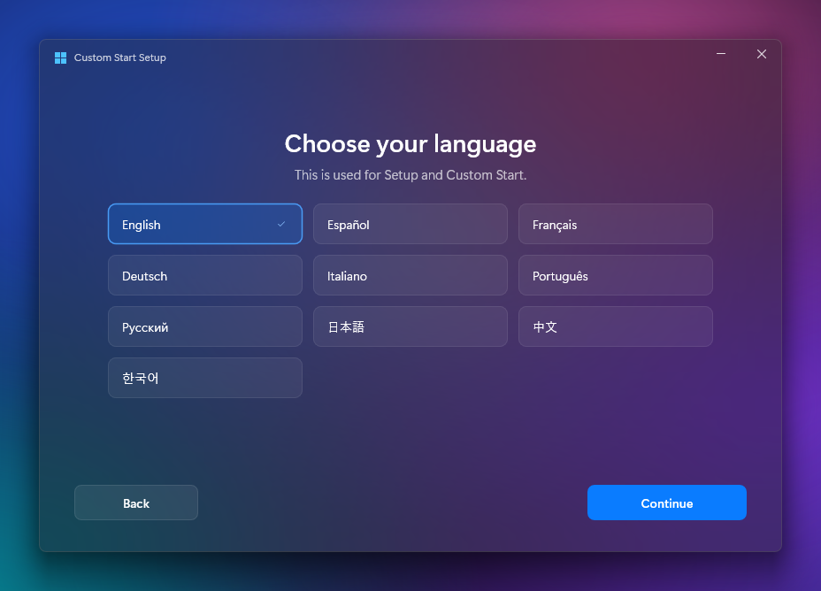
<b>2.</b> Pick your language
</td>
  </tr>
  <tr>
    <td width="50%" valign="top">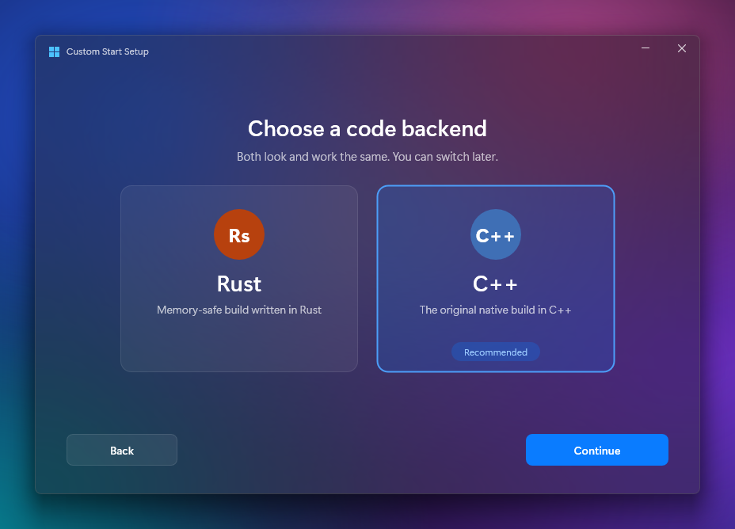
<b>3.</b> Choose the C++ or Rust backend
</td>
    <td width="50%" valign="top">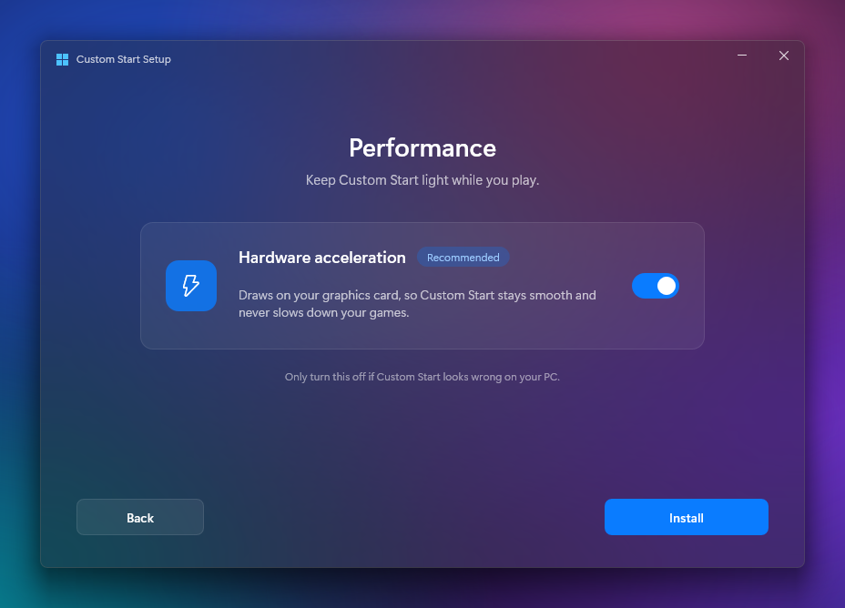
<b>4.</b> Hardware acceleration, on by default
</td>
  </tr>
  <tr>
    <td valign="top" colspan="2" align="center">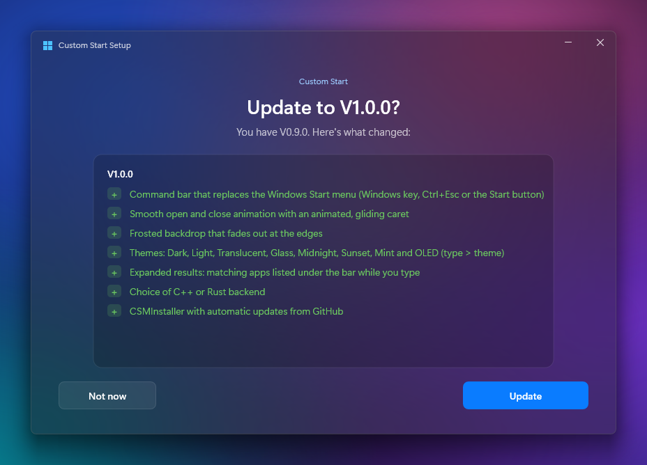
<b>Later:</b> updates arrive with a changelog
</td>
  </tr>
</table>

Uninstall any time from **Settings → Apps**.

## ⌨️ Shortcuts

| Key | Action |
| --- | --- |
| <kbd>Win</kbd> · <kbd>Ctrl</kbd>+<kbd>Esc</kbd> · Start button | Open or close Custom Start |
| <kbd>Enter</kbd> | Open the selected app |
| <kbd>Shift</kbd>+<kbd>Enter</kbd> | Run exactly what you typed |
| <kbd>Ctrl</kbd>+<kbd>Shift</kbd>+<kbd>Enter</kbd> | Run as administrator |
| <kbd>Tab</kbd> · <kbd>→</kbd> | Accept the completion |
| <kbd>↑</kbd> <kbd>↓</kbd> · <kbd>PgUp</kbd> <kbd>PgDn</kbd> | Move through results |
| Right-click · <kbd>Menu</kbd> key | App menu (administrator, file location, pin) |
| Drag a pinned tile | Reorder pinned apps |
| <kbd>Esc</kbd> | Close |
| `> games` · `> pins` · `> theme` · `> font` · `> fontfolder` · `> expanded` · `> startup` · `> quit` | Commands |

## 📊 Analytics

<table>
  <tr>
    <td><b>Downloads</b></td>
    <td>
      
      
    </td>
  </tr>
  <tr>
    <td><b>By file</b></td>
    <td>
      
      
      
    </td>
  </tr>
  <tr>
    <td><b>Community</b></td>
    <td>
      
      
      
      
    </td>
  </tr>
  <tr>
    <td><b>Activity</b></td>
    <td>
      
      
      
    </td>
  </tr>
  <tr>
    <td><b>Code</b></td>
    <td>
      
      
      
    </td>
  </tr>
</table>

  <a href="https://star-history.com/#mysisnotreal/CustomStartMenu&Date">
    <picture>
      <source media="(prefers-color-scheme: dark)" srcset="https://api.star-history.com/svg?repos=mysisnotreal/CustomStartMenu&type=Date&theme=dark">
      
    </picture>
  </a>

## 📄 License

[MIT](LICENSE). The hand-drawn "hello" in Setup comes from [Apple OOBE hello](https://codepen.io/steefmaster/pen/MWvdyGb) on CodePen (MIT).

Made for Windows 11 · If you like it, leave a ⭐

